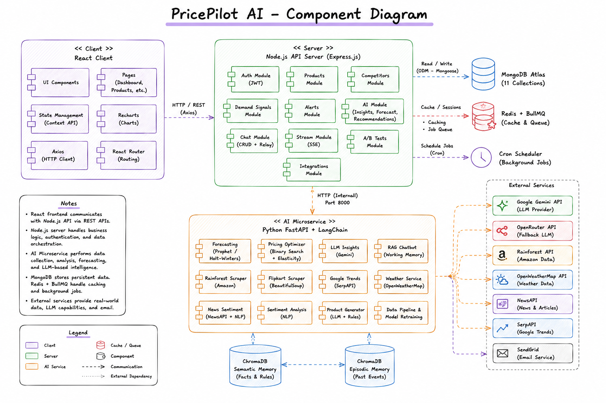
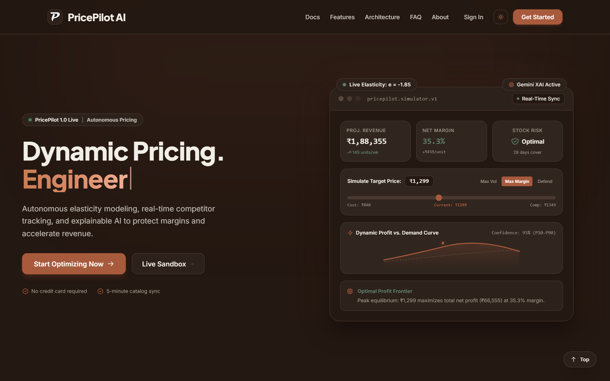
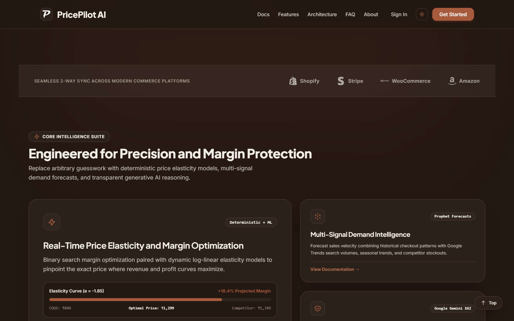
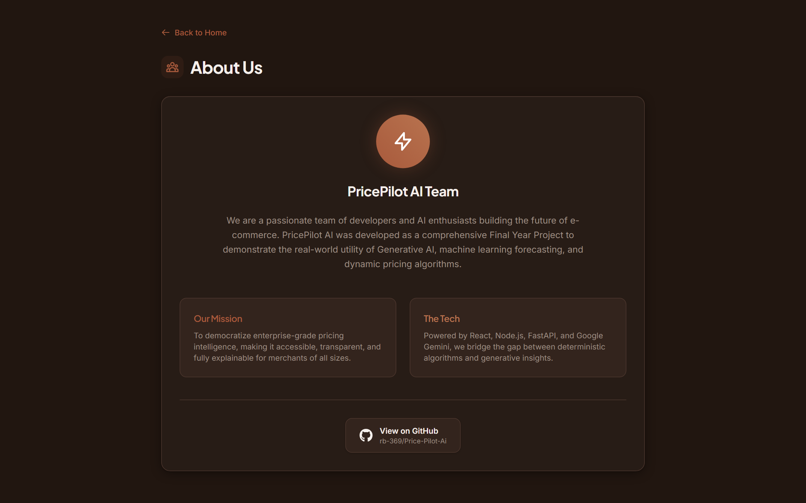
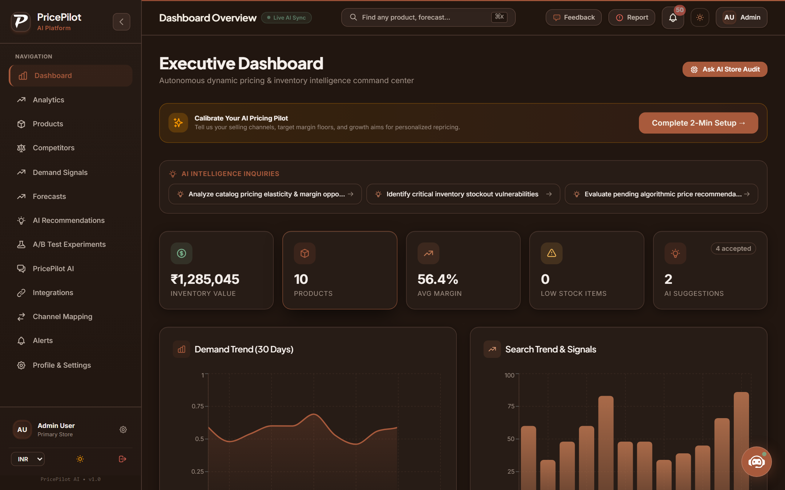
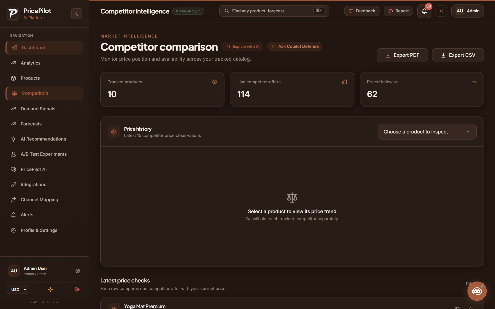
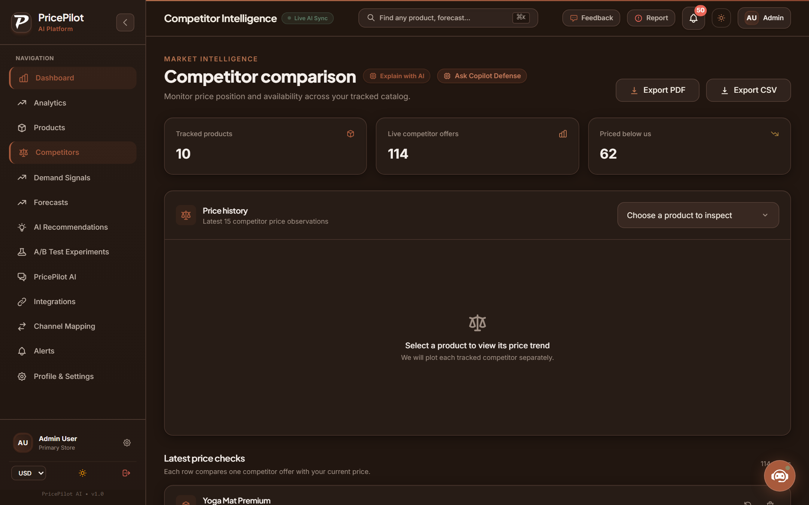
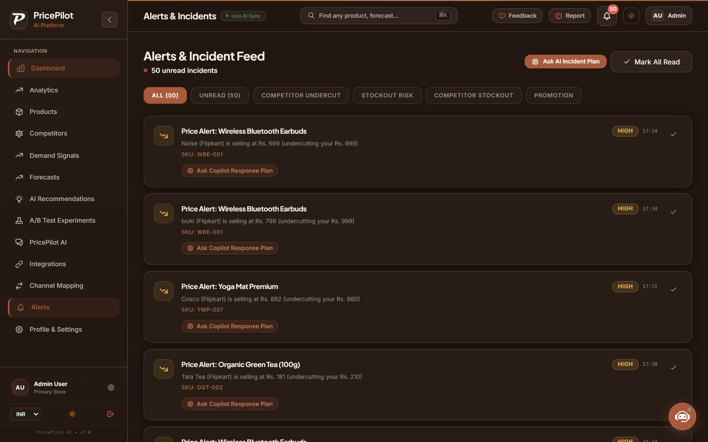

<p align="center">
  <picture>
    <source media="(prefers-color-scheme: dark)" srcset="client/src/assets/new_dark_logo.png" />
    <source media="(prefers-color-scheme: light)" srcset="client/src/assets/new_light_logo.png" />
    
  </picture>
</p>

<h1 align="center">🚀 PricePilot AI — Dynamic Pricing & Inventory Intelligence Platform</h1>

<p align="center">
  <strong>An autonomous, multi-channel e-commerce pricing optimization and inventory intelligence platform powered by LangGraph multi-agent swarms, Bayesian price elasticity modeling, Prophet time-series forecasting, and conversational RAG copilots.</strong>
</p>

<p align="center">
  
  
  
  
  
  
  
  
  
  
  
  
</p>

---

## 📋 Academic Project Information

| Field | Details |
|-------|---------|
| **Course Name** | Project |
| **Course Code** | PRO230812 |
| **Department** | CSE (Computer Science and Engineering) |
| **Semester** | V |
| **Topic** | PricePilot AI – Dynamic Pricing and Inventory Intelligence Platform |
| **Academic Year** | 2025–2026 |
| **Institution** | Final Year Project |

### 👥 Team Members

| Name | Roll No. | Role & Contribution |
|------|----------|---------------------|
| **Rudra Babar** | B002 | Architecture, AI Microservices, LangGraph Agents, Backend APIs, Evaluation Harness |
| **Aryan Desale** | B010 | Full-Stack Engineering, Frontend UI/UX, Stacking Card Animations, Design Systems |

---

## 📖 Table of Contents

- [About the Project](#-about-the-project)
- [Key Features](#-key-features)
- [System Architecture](#-system-architecture)
- [Multi-Agent & RAG Workflows](#-multi-agent--rag-workflows)
- [Architecture Diagrams](#-architecture-diagrams)
- [Screenshots & Visual Showcase](#-screenshots--visual-showcase)
- [Tech Stack](#-tech-stack)
- [Project Structure](#-project-structure)
- [Getting Started](#-getting-started)
- [Environment Variables](#-environment-variables)
- [API Reference](#-api-reference)
- [ML Evaluation & Benchmark Harness](#-ml-evaluation--benchmark-harness)
- [Deployment](#-deployment)
- [Research Papers & Inspiration](#-research-papers--inspiration)
- [License](#-license)

---

## 🎯 About the Project

**PricePilot AI** is a production-grade, full-stack revenue optimization and inventory intelligence platform engineered for multi-channel e-commerce businesses. Modern merchants selling across independent direct-to-consumer (D2C) storefronts and high-velocity marketplaces (Amazon, Flipkart, Shopify, WooCommerce) face severe margin erosion from static markup heuristics, unpredictable competitor repricing, supply chain stockouts, and black-box pricing opacity.

PricePilot AI solves this through a decoupled three-tier microservice architecture that combines **Bayesian price elasticity estimation**, **Facebook Prophet time-series forecasting**, **LangGraph multi-agent competitor swarms**, and **Retrieval-Augmented Generation (RAG)** copilots with **Explainable AI (XAI)** decision narratives.

### Core Problems Solved

1. **The Static Markup Fallacy**: Over 75% of SME merchants use fixed cost-plus markups (e.g. +30% on COGS), leaving significant margin on the table during demand surges and losing sales when competitors undercut. PricePilot dynamically optimizes gross margins via binary search and elasticity curves.
2. **Competitor Blind Spots & Self-Brand Pollution**: Scraping competitors manually is slow and error-prone; naive keyword search often matches a brand's own products or unrelated accessories. PricePilot's LangGraph agent cleans brand tokens, detects generic categories, enforces strict anti-self-brand filtering, and discovers true tier rivals.
3. **Multi-Signal Demand Swings**: Consumer willingness-to-pay shifts based on seasonality, weather conditions, news sentiment, and search interest trends. PricePilot synthesizes external telemetry into a unified 0–100 composite demand score.
4. **Black-Box Opacity**: Merchants reject algorithmic pricing when they cannot understand the mathematical rationale. PricePilot pairs every price recommendation with plain-English LLM explanations, elasticity sensitivity charts, and one-click "Explain with AI" tags.
5. **Multi-Channel Desynchronization**: Changing prices in isolation leads to mismatched margins and marketplace penalty. PricePilot supports synchronized multi-channel commits across Amazon, Flipkart, and Shopify.

---

## ✨ Key Features

### 🤖 AI-Powered Pricing Engine & What-If Simulation
- **Binary Search Gross Profit Maximizer**: Mathematically locates the exact unit price point that maximizes total expected profit while respecting minimum margin floors and maximum markup ceilings.
- **Dynamic Price Elasticity Estimation**: Estimates category-specific price sensitivity ($\epsilon$) using historical sales volume, competitor price differentials, and composite demand multipliers.
- **Interactive What-If Scenario Simulator (`WhatIfSimulator.jsx`)**:
  - **Strategic Verdict Badges**: Classifies proposed simulations into intuitive strategies (*Margin Maximizer*, *Market Share Grab*, *Margin Risk*, *Volume Loss Risk*).
  - **Simple & Advanced Simulation Modes**: High-level sliders for target price, competitor counter-moves, and demand multipliers alongside granular COGS overrides and time horizons.
  - **Profit Frontier & Sensitivity Curves**: Interactive Recharts visualizations displaying projected revenue, profit delta, unit volume, and margin health before committing.
  - **Multi-Channel Price Commitment**: Apply simulated price changes directly to the catalog and sync across configured sales channels with a single click.
- **Explainable AI (XAI) Decision Cards**: Every recommendation is paired with transparent mathematical breakdowns and plain-English narratives generated via Google Gemini.

### 🕵️ LangGraph Autonomous Competitor Intelligence Agent
- **StateGraph Orchestrated Swarm (`competitor_agent.py`)**: A multi-step autonomous agent workflow that transitions through Brand Sanitization $\rightarrow$ Generic Product Extraction $\rightarrow$ Category Classification $\rightarrow$ Anti-Self-Brand Filtering $\rightarrow$ Rival Discovery $\rightarrow$ Multi-Query Generation $\rightarrow$ Live Scraping $\rightarrow$ Price Normalization.
- **Strict Anti-Self-Brand Guardrails**: Eliminates false comparisons by strictly prohibiting the seller's own brand from appearing in competitor benchmarks.
- **Multi-Tier LLM Resilience**:
  - **Primary**: OpenRouter running high-reasoning models (NVIDIA Nemotron 70B / Qwen free tier).
  - **Fallback**: Google Gemini (Gemini 2.5 Flash / Flash Latest).
  - **Safety Net**: Deterministic category heuristics and regex-based brand sanitizers when upstream APIs are offline.
- **Live Distributed Web Scraping**: Real-time Amazon telemetry via Rainforest API paired with BeautifulSoup-powered scraping for Flipkart India.

### 💬 Conversational AI Copilot (4-Tier Cognitive Memory RAG)
- **4-Tier Cognitive Architecture**:
  1. **Working Memory (Context RAM)**: Dynamically constructs the active context window combining System Persona, Session History, Semantic Facts, Episodic History, and Real-Time Catalog Telemetry.
  2. **Semantic Memory (ChromaDB)**: Durable store of catalog specifications, store policies, and pricing rules retrieved via cosine similarity embeddings.
  3. **Episodic Memory (ChromaDB)**: Session-tagged historical conversations and user feedback logs for contextual continuity.
  4. **Procedural Memory**: Standard operating procedures, pricing rule playbooks, and calculation routines.
- **Interactive Slash Commands**: Popover autocomplete for `/what-if`, `/explain-simply`, `/analyze-competitors`, `/demand-signals`, `/inventory-forecast`, and `/pricing-recommendation`.
- **Inline `@Product` Catalog Tagging**: Type `@` anywhere in the chat prompt to inject live SKU, inventory, and cost chips directly into the conversation.
- **Executable What-If Scenario Cards**: Chatbot responses can generate clickable cards that pre-populate and launch the What-If Simulator modal.
- **Multi-Tier LLM Resilient Routing**: Automatic failover between Gemini, OpenRouter, and contextual local catalog summaries.

### 📊 Time-Series Demand Forecasting & Inventory Health
- **Facebook Prophet Integration**: Bayesian decomposable time-series modeling capturing weekly/monthly seasonality, holiday shifts, and non-linear trend dynamics.
- **Graceful Statistical Fallbacks**: Automatically degrades to Holt-Winters Exponential Smoothing or Weighted Moving Averages when historical volume is sparse.
- **30-Day Forward Forecast Horizon**: Delivers daily order volume projections accompanied by statistical confidence intervals (70–95%).
- **Intelligent Reorder Alerts**: Automatically calculates stock depletion runway and flags reorder quantities to avert stockouts.

### 🌐 Multi-Signal Demand Intelligence
- **OpenWeatherMap Integration**: Ingests regional weather telemetry to adjust demand multipliers for weather-sensitive categories.
- **NewsAPI + NLP Sentiment Scoring**: Evaluates market trends, supply chain news, and consumer sentiment to bias demand predictions.
- **Google Trends Telemetry**: Real-time relative search interest tracking for leading category keywords.
- **Catalog Demand Intensity Heatmap**: Interactive visual dashboard summarizing demand momentum across all inventory SKUs.

### 📑 Executive PDF Reporting & Telemetry
- **One-Click Executive PDF Export**: Download presentation-ready PDF reports directly from the Recommendations, Competitor Intelligence, and A/B Testing pages.
- **In-App Issue & UX Telemetry Reporting (`ReportModal.jsx`)**: System reporting modal capturing viewport dimensions, user agents, active URLs, severity classification, and issue descriptions directly to backend storage.

### 🎨 Interactive Stacking Card Motion & Fluid Navigation
- **Scroll-Stacking & 2x2 Grid Spread Animation (`stacking-card.jsx`)**: Smooth card-over-card scroll stacking transitioning into an interactive 2x2 grid spread on desktop.
- **Universal Command Palette (`Cmd+K`)**: Instant modal search across products, routes, forecasts, and alert logs.
- **Agency-Grade Design Tokens**: Refined terracotta (`#A85A3C`), sage green (`#5F806B`), and warm dark/light themes with micro-interactions.

### 🧪 A/B Testing & Elasticity Validation
- **Multi-Armed Bandit Experimentation**: Split-test price variants using Thompson Sampling to maximize cumulative reward while testing elasticity hypotheses.
- **Statistical Significance Tracking**: P-value and confidence interval indicators to ensure pricing changes are validated before permanent rollout.

### 🔐 Enterprise Security & Reliability
- **Google OAuth 2.0 & JWT Authentication**: One-click Google sign-in (`@react-oauth/google`) and secure bcrypt-hashed token flows.
- **Defensive API Hardening**: Rate limiting (`express-rate-limit`), NoSQL injection sanitization (`express-mongo-sanitize`), XSS protection (`xss-clean`), and HTTP security headers (`Helmet`).
- **Universal 3-Bar Chart Loader (`PricePilotChartLoader.jsx`)**: Animated chart loaders with authentic auth and product addition sync buffers.
- **Redis Caching & BullMQ Task Queues**: Sub-second dashboard load times via aggregation caching and asynchronous background AI job queues.

---

## 🏗️ System Architecture

PricePilot AI is organized as a decoupled three-tier microservices architecture:

```
┌────────────────────────────────────────────────────────────────────────────────────────┐
│                                 PRICEPILOT AI TOPOLOGY                                 │
└────────────────────────────────────────────────────────────────────────────────────────┘

  ┌────────────────────────────────────────────────────────────────────────────────────┐
  │                               CLIENT TIER (React 19 + Vite 7)                      │
  │  Landing (Stacking Motion) · Dashboard · Products · Competitors · Demand Signals   │
  │  Forecasts · Recommendations (PDF Export) · What-If Simulator · Chat Copilot (RAG) │
  │  Alerts · A/B Testing · Integrations · Analytics · Copilot · Command Palette       │
  │                     Tailwind CSS 4 · Recharts · Axios · Hot Toast                  │
  └────────────────────────────────────────┬───────────────────────────────────────────┘
                                           │ HTTPS / JWT Bearer
                                           ▼
  ┌────────────────────────────────────────────────────────────────────────────────────┐
  │                          API GATEWAY TIER (Node.js 20 / Express 4)                 │
  │                                                                                    │
  │  Route Groups: Auth · Products · Competitors · Demand · Alerts · AI · Chat · SSE   │
  │                Simulator · Reports · Sales · Channel Mapping · Feedback           │
  │                                                                                    │
  │  Middleware: JWT Verify · Rate Limiter · Helmet · Mongo Sanitize · XSS Clean       │
  │  Background: Node-Cron Price Checks · Alert Dispatcher · BullMQ Worker Queues      │
  ├────────────────────────┬───────────────────────────┬───────────────────────────────┤
  │   MongoDB Atlas        │    Redis 7 / BullMQ       │   External Notification APIs  │
  │   11 Document Models   │    In-Memory Cache & Queue│   SendGrid · Google OAuth     │
  └────────────────────────┴─────────────┬─────────────┴───────────────────────────────┘
                                         │ Internal HTTP / JSON
                                         ▼
  ┌────────────────────────────────────────────────────────────────────────────────────┐
  │                          AI ENGINE TIER (Python 3.12 / FastAPI)                    │
  │                                                                                    │
  │  ┌─────────────────────────┐  ┌─────────────────────────┐  ┌────────────────────┐  │
  │  │ LangGraph Competitor    │  │ What-If Simulator       │  │ Prophet Demand     │  │
  │  │ Agent (Multi-Tier LLM)  │  │ (Elasticity Engine)     │  │ Forecasting        │  │
  │  └─────────────────────────┘  └─────────────────────────┘  └────────────────────┘  │
  │  ┌─────────────────────────┐  ┌─────────────────────────┐  ┌────────────────────┐  │
  │  │ RAG Conversational      │  │ Pricing Optimization    │  │ Rainforest Amazon  │  │
  │  │ Copilot (4-Tier Memory) │  │ (Binary Search Profit)  │  │ & Flipkart Scrapers│  │
  │  └─────────────────────────┘  └─────────────────────────┘  └────────────────────┘  │
  │  ┌─────────────────────────┐  ┌─────────────────────────┐  ┌────────────────────┐  │
  │  │ Multi-Signal Demand     │  │ ML Retraining &         │  │ Offline Evaluation │  │
  │  │ (Weather/News/Trends)   │  │ Pipeline Ingestion      │  │ Harness (6 Suites) │  │
  │  └─────────────────────────┘  └─────────────────────────┘  └────────────────────┘  │
  │                                                                                    │
  │  Vector Stores: ChromaDB (Semantic Memory + Episodic Memory)                       │
  │  LLM Engines: OpenRouter (Nemotron 70B) ── fallback ──▶ Google Gemini (Flash)      │
  └────────────────────────────────────────────────────────────────────────────────────┘
```

---

## 🤖 Multi-Agent & RAG Workflows

### 1. LangGraph Autonomous Competitor Intelligence Workflow

```
[Raw Product Input (Title, Brand, Price, ASIN)]
                     │
                     ▼
       ┌───────────────────────────┐
       │     Brand Sanitizer       │ ── Heuristic regex cleans noise & store tokens
       └─────────────┬─────────────┘
                     ▼
       ┌───────────────────────────┐
       │    Generic Type & Tier    │ ── Extracts generic product archetype & category
       └─────────────┬─────────────┘
                     ▼
       ┌───────────────────────────┐
       │  Anti-Self-Brand Filter   │ ── Strictly prevents self-brand in competitor pool
       └─────────────┬─────────────┘
                     ▼
       ┌───────────────────────────┐
       │   Rival Brand Discovery   │ ── LLM (Nemotron / Gemini) identifies 4-5 direct rivals
       └─────────────┬─────────────┘
                     ▼
       ┌───────────────────────────┐
       │ High-Converting Queries   │ ── Forms "Brand + Generic Type" search matrices
       └─────────────┬─────────────┘
                     ▼
       ┌───────────────────────────┐
       │ Concurrent Web Scraping   │ ── Rainforest API (Amazon) + BeautifulSoup (Flipkart)
       └─────────────┬─────────────┘
                     ▼
       ┌───────────────────────────┐
       │ Price Normalization & XAI │ ── Maps price gravity, outlier clipping, and confidence
       └───────────────────────────┘
```

### 2. Conversational RAG Copilot (4-Tier Memory Session)

```
┌─────────────────────────────────────────────────────────────────────────────┐
│                       EPHEMERAL WORKING MEMORY RAM                          │
│                                                                             │
│  User Query + Chat History + System Persona                                │
│    + Semantic Context (ChromaDB top-k facts, catalog specs, policies)       │
│    + Episodic Context (ChromaDB past user conversations & feedback)        │
│    + Real-Time Telemetry (Live product price, margin, stock, competitors)   │
└──────────────────────────────────────┬──────────────────────────────────────┘
                                       │ Assembled Context
                                       ▼
                       ┌───────────────────────────────┐
                       │       Primary LLM Provider    │
                       │     (Google Gemini 2.5 Flash) │
                       └───────────────┬───────────────┘
                                       │ (On 503 / Quota Error)
                                       ▼
                       ┌───────────────────────────────┐
                       │     Fallback LLM Provider     │
                       │   (OpenRouter / Nemotron 70B) │
                       └───────────────┬───────────────┘
                                       │
                                       ▼
                       ┌───────────────────────────────┐
                       │   Synthesized Copilot Reply   │
                       │ + Actionable What-If Cards    │
                       └───────────────┬───────────────┘
                                       │ (Async Fire-and-Forget)
                                       ▼
                       ┌───────────────────────────────┐
                       │   Save to Episodic Memory     │
                       │          (ChromaDB)           │
                       └───────────────────────────────┘
```

---

## 📐 Architecture Diagrams

The complete architectural specification is captured in five high-resolution diagrams:

### 1. High-Level 3-Tier System Architecture
The foundational topology mapping the React Client, Node.js Gateway, FastAPI Intelligence Service, and external telemetry pipelines.


---

### 2. Level 1 Data Flow Diagram (DFD)
Illustrates how data traverses the platform across 8 core processes and 7 persistent data stores.


---

### 3. RAG Chatbot & Memory Architecture
Details the Ephemeral Working Memory, Semantic/Episodic vector stores, and dual-tier LLM routing.


---

### 4. Full-Stack Component Diagram
UML Component view showing concrete module boundaries, database bindings, caching tiers, and external third-party APIs.



---

### 5. Complete User Journey Sequence Diagram
Step-by-step trace covering merchant authentication, Redis cache checks, Prophet demand forecasting, Gemini insight synthesis, and dashboard rendering.


---

## 📸 Screenshots & Visual Showcase

> _The interface features an agency-grade dark/light glassmorphism design system built with custom terracotta (`#A85A3C`), sage green (`#5F806B`), and copper design tokens, responsive typography, and micro-animations._

### 🌟 1. Landing Experience & Public Showcase

#### Hero & First Impression
*Modern dark-mode hero featuring glowing radial gradients, real-time value proposition, and instant CTA navigation.*


#### Desktop Landing Page with Feature Showcase
*Full public landing page with interactive scroll stacking and 2x2 spread animation showcasing core platform capabilities.*


#### About Us & Mission Statement
*Dedicated team, mission, and architecture overview presenting project goals and GitHub repository links.*


---

### 📊 2. Executive Analytics & Inventory Management

#### Executive Dashboard
*Real-time KPI metrics (total revenue, product count, gross margin, low-stock warnings, pending recommendations) alongside 30-day revenue trends and daily order volume.*


#### Product Catalog Management
*Comprehensive inventory table with inline stock editing, SKU tracking, margin calculation, and instant product addition.*


---

### 🏷️ 3. Competitor Intelligence & Scraping Telemetry

#### Multi-Marketplace Price History Trends
*Interactive multi-line price history graph tracking price fluctuations across Amazon, Flipkart, Meesho, Myntra, and Snapdeal.*


#### Competitor Benchmark Table & Real-Time Stock Status
*Detailed benchmark grid displaying competitor prices, percentage differentials, stock status (In Stock / OOS), and direct marketplace links.*


---

### 📈 4. Multi-Signal Demand Intelligence & Forecasting

#### Catalog-Wide Demand Intensity Heatmap
*Color-coded demand intensity grid visualizing relative demand scores across all catalog SKUs.*


#### Multi-Signal Radar Breakdown & 14-Day Score Trends
*Multi-factor radar chart breaking down Search Trends, Weather, Events, and Sentiment scores alongside a 14-day chronological momentum chart.*


#### Prophet Bayesian Inventory & Demand Forecasts
*30-day forward demand predictions with statistical confidence ratings, stock depletion rates, and recommended reorder quantities.*


---

### 💡 5. AI Pricing Recommendations & Alert Center

#### AI Pricing Recommendations Feed & PDF Export
*Actionable price recommendations featuring current vs. recommended prices, expected revenue impact, confidence scores, plain-English LLM explanations, live competitor benchmarks, and one-click Executive PDF export.*


#### Severity-Prioritized Alerts & Notification Inbox
*Multi-tier notification inbox categorizing alerts by severity (High, Medium, Low) for competitor undercuts, stockout risks, and surge pricing opportunities.*


---

## 🛠️ Tech Stack

### Frontend Architecture
| Technology | Version | Purpose |
|------------|---------|---------|
| **React** | 19.x | Component-driven UI framework |
| **Vite** | 7.x | Next-generation build tool & HMR dev server |
| **Tailwind CSS** | 4.x | Utility-first styling & unified design token architecture |
| **Recharts** | 2.x | High-performance SVG data visualizations |
| **React Router** | 7.x | Client-side routing with direct route aliases |
| **@react-oauth/google** | 0.12.x | Google OAuth 2.0 Web authentication |
| **Axios** | 1.x | HTTP client with automatic JWT interceptors |
| **React Hot Toast** | 2.x | Lightweight, accessible notification toasts |
| **React Icons** | 5.x | Crisp vector SVG icons replacing legacy emojis |

### Backend API Gateway (Node.js)
| Technology | Version | Purpose |
|------------|---------|---------|
| **Node.js** | 20.x | Server runtime environment |
| **Express** | 4.x | REST API microframework |
| **MongoDB & Mongoose** | 8.x | Document database & Object Data Modeling (ODM) |
| **Redis** | 7.x | High-speed in-memory metric caching |
| **BullMQ** | 5.x | Asynchronous background job queues |
| **JSON Web Token (JWT)** | 9.x | Cryptographic session tokens |
| **bcryptjs** | 2.x | Secure salted password hashing |
| **Helmet** | 8.x | Comprehensive HTTP security headers |
| **express-mongo-sanitize** | 2.x | NoSQL injection prevention |
| **xss-clean** | 0.1.x | Cross-Site Scripting (XSS) payload sanitization |
| **express-rate-limit** | 7.x | IP-based request throttling |
| **node-cron** | 3.x | Scheduled price check and alert jobs |
| **Winston & Morgan** | 3.x | Structured JSON HTTP logging |

### AI Microservice (Python)
| Technology | Version | Purpose |
|------------|---------|---------|
| **Python** | 3.12 | Microservice runtime |
| **FastAPI** | 0.110+ | Asynchronous REST microservice framework |
| **Uvicorn** | 0.29+ | ASGI production web server |
| **LangGraph** | 0.0.30+ | Multi-agent state graph orchestration |
| **LangChain** | 0.1+ | RAG pipeline and prompt chain engineering |
| **ChromaDB** | 0.4+ | Persistent vector database for semantic & episodic memory |
| **Facebook Prophet** | 1.1+ | Bayesian decomposable time-series forecasting |
| **Google Gemini (GenAI)** | 2.5 Flash | Primary LLM for conversational RAG & explanations |
| **OpenRouter API** | Free Pool | Fallback LLM (NVIDIA Nemotron 70B / Qwen) |
| **Rainforest API** | REST | Real-time Amazon marketplace price extraction |
| **BeautifulSoup4** | 4.12+ | Flipkart product scraping & HTML parsing |
| **SciPy & Statsmodels** | 1.12+ | Econometric elasticity regressions & statistical fallbacks |
| **Pandas & NumPy** | 2.2+ | High-throughput matrix and time-series computations |
| **HTTPX** | 0.27+ | Asynchronous HTTP client for distributed web requests |
| **pytest & pytest-asyncio** | 8.x | Automated microservice and evaluation test suites |

---

## 📁 Project Structure

```
ecom-ai-project/
├── client/                          # React 19 Frontend (Vite + Tailwind CSS 4)
│   ├── src/
│   │   ├── api/
│   │   │   └── index.js             # Centralized Axios client & API methods
│   │   ├── assets/                  # Logos (dark/light), SVG icons, brand assets
│   │   ├── components/
│   │   │   ├── Layout.jsx           # App shell with desktop sidebar & responsive nav
│   │   │   ├── Sidebar.jsx          # Collapsible desktop sidebar navigation
│   │   │   ├── Header.jsx           # Top navigation bar with Cmd+K search & sync state
│   │   │   ├── MobileBottomNav.jsx  # Mobile thumb-zone bottom navigation bar
│   │   │   ├── MobileHeroCards.jsx  # Mobile horizontal KPI carousel
│   │   │   ├── MobileSearchModal.jsx# Universal Cmd+K quick search modal
│   │   │   ├── WhatIfSimulator.jsx  # Interactive scenario pricing simulator
│   │   │   ├── ReportModal.jsx      # Executive issue & telemetry reporting modal
│   │   │   ├── ExplainabilityPanel.jsx # Mathematical decision explanation card
│   │   │   ├── ExplainWithAITag.jsx # Inline tag launching RAG explanation
│   │   │   ├── AskAIButton.jsx      # Context-injected AI chat launcher
│   │   │   ├── ChatWidget.jsx       # Floating AI copilot drawer
│   │   │   ├── ChatAutocompletePopover.jsx # Slash command & @Product popover
│   │   │   ├── PricePilotChartLoader.jsx # Universal 3-bar animated chart loader
│   │   │   ├── Animated404.jsx      # Interactive 404 bar chart animation
│   │   │   ├── ErrorBoundary.jsx    # React error boundary with trace inspector
│   │   │   └── ui/
│   │   │       └── stacking-card.jsx# 2x2 spread animation & scroll stacking
│   │   ├── context/
│   │   │   ├── AuthContext.jsx      # JWT & Google OAuth authentication state
│   │   │   ├── ThemeContext.jsx     # Dark/Light theme manager & CSS variables
│   │   │   └── CurrencyContext.jsx  # Multi-currency exchange rate manager
│   │   ├── pages/
│   │   │   ├── Landing.jsx          # Public landing page with scroll stacking
│   │   │   ├── Dashboard.jsx        # Executive KPI & revenue analytics dashboard
│   │   │   ├── Products.jsx         # Product catalog management with CRUD
│   │   │   ├── Competitors.jsx      # Competitor price history & benchmark table
│   │   │   ├── DemandSignals.jsx    # Multi-signal demand & weather radar
│   │   │   ├── Forecasts.jsx        # Prophet Bayesian 30-day demand forecasts
│   │   │   ├── Recommendations.jsx  # AI pricing suggestions feed with PDF export
│   │   │   ├── ABTestDashboard.jsx  # Price elasticity A/B experiments dashboard
│   │   │   ├── ChannelMapping.jsx   # Multi-channel marketplace connector
│   │   │   ├── Analytics.jsx        # Deep revenue & sales volume analytics
│   │   │   ├── Chat.jsx             # Dedicated AI conversation workspace
│   │   │   ├── Alerts.jsx           # Severity-prioritized alert inbox
│   │   │   ├── Integrations.jsx     # External API credentials management
│   │   │   ├── Settings.jsx         # Profile preferences & avatar customization
│   │   │   ├── About.jsx            # About Us page, project mission & team
│   │   │   ├── Docs.jsx             # In-app platform documentation
│   │   │   ├── Demo.jsx             # Interactive interactive preview
│   │   │   ├── Onboarding.jsx       # New merchant store onboarding wizard
│   │   │   ├── Login.jsx            # Sign in with email or Google OAuth
│   │   │   ├── Register.jsx         # Account registration
│   │   │   ├── ForgotPassword.jsx   # Password recovery email request
│   │   │   ├── ResetPassword.jsx    # Secure token-based password reset
│   │   │   └── NotFound.jsx         # Custom animated 404 page
│   │   ├── App.jsx                  # Root router with direct alias guards
│   │   ├── index.css                # Global styles, variables & design tokens
│   │   └── main.jsx                 # React entry point
│   ├── index.html
│   ├── vite.config.js
│   └── package.json
│
├── server/                          # Node.js 20 Backend (Express 4)
│   ├── config/
│   │   ├── db.js                    # MongoDB Atlas Mongoose connection
│   │   └── logger.js                # Winston structured logger
│   ├── controllers/
│   │   ├── aiController.js          # AI recommendation & forecast logic
│   │   ├── authController.js        # JWT auth, Google OAuth & password reset
│   │   ├── chatController.js        # Chat CRUD & RAG proxy relay
│   │   ├── productController.js     # Product management & inline updates
│   │   ├── competitorController.js  # Competitor price tracking
│   │   ├── demandController.js      # Demand signal management
│   │   ├── alertController.js       # Alert inbox CRUD
│   │   ├── abTestController.js      # A/B test experiment management
│   │   ├── simulatorController.js   # What-If scenario simulation & commit
│   │   ├── reportController.js      # Issue & telemetry report handler
│   │   ├── salesController.js       # Sales order webhook & CSV upload
│   │   ├── mappingController.js     # Channel mapping & AI auto-match
│   │   └── integrationController.js # External API credentials hub
│   ├── middleware/
│   │   ├── auth.js                  # JWT authentication middleware
│   │   └── rateLimiter.js           # Express rate limiting
│   ├── models/
│   │   ├── User.js                  # User schema & password hashing
│   │   ├── Product.js               # Product catalog schema
│   │   ├── Chat.js                  # Conversation session schema
│   │   ├── CompetitorPrice.js       # Scraped competitor price schema
│   │   ├── DemandSignal.js          # Demand signal schema
│   │   ├── PricingRecommendation.js # Pricing suggestion schema
│   │   ├── InventoryForecast.js     # Forecast cache schema
│   │   ├── Alert.js                 # Alert notification schema
│   │   ├── ABTest.js                # A/B test experiment schema
│   │   ├── Report.js                # System issue & UX telemetry schema
│   │   └── Integration.js           # Integration credential schema
│   ├── routes/                      # Express route groups
│   ├── cron/                        # Scheduled jobs (price scraping & alerts)
│   ├── seed/                        # Database seeding scripts
│   ├── services/                    # Integration & email services
│   ├── server.js                    # Express app entry point
│   └── package.json
│
├── ai-service/                      # Python 3.12 AI Service (FastAPI)
│   ├── routes/
│   │   ├── forecast.py              # Prophet demand forecast endpoint
│   │   ├── optimize.py              # Price optimization endpoint
│   │   ├── insights.py              # LLM insight generation endpoint
│   │   ├── scraper.py               # Amazon & Flipkart scraping routes
│   │   ├── chat.py                  # RAG conversational endpoint
│   │   ├── simulator.py             # What-If simulation endpoint
│   │   ├── product_gen.py           # AI product content generation
│   │   ├── sentiment.py             # Text sentiment analysis endpoint
│   │   ├── data_pipeline.py         # Real data ingestion pipeline
│   │   └── retrain.py               # ML model retraining endpoint
│   ├── services/
│   │   ├── competitor_agent.py      # LangGraph Competitor Intelligence Agent
│   │   ├── simulator.py             # Predictive What-If simulation service
│   │   ├── chatbot.py               # RAG chatbot with WorkingMemory RAM
│   │   ├── vector_store.py          # ChromaDB semantic & episodic memory
│   │   ├── forecasting.py           # Prophet & Holt-Winters models
│   │   ├── pricing.py               # Binary search gross profit optimizer
│   │   ├── elasticity_model.py      # Bayesian price elasticity estimation
│   │   ├── llm_insights.py          # Google Gemini integration
│   │   ├── rainforest.py            # Amazon scraping (Rainforest API)
│   │   ├── flipkart_scraper.py      # Flipkart BeautifulSoup scraper
│   │   ├── google_trends.py         # Google Trends search telemetry
│   │   ├── weather.py               # OpenWeatherMap weather service
│   │   ├── news_sentiment.py        # NewsAPI sentiment pipeline
│   │   ├── sentiment.py             # Text sentiment classifier
│   │   ├── validator.py             # Output validation & safety guardrails
│   │   └── model_registry.py        # ML artifact serialization & registry
│   ├── evaluation/                  # Comprehensive Evaluation Harness
│   │   ├── eval_pricing.py          # Pricing optimization margin test suite
│   │   ├── eval_forecasting.py      # Demand forecast MAPE/RMSE suite
│   │   ├── eval_elasticity.py       # Elasticity calibration test suite
│   │   ├── eval_demand_signals.py   # Multi-signal sensitivity test suite
│   │   ├── eval_ab_testing.py       # Thompson sampling bandit convergence
│   │   ├── eval_chatbot.py          # RAG context faithfulness & relevance
│   │   ├── metrics.py               # Common evaluation scoring metrics
│   │   └── run_all.py               # Unified evaluation runner
│   ├── models/                      # ML model artifacts & ChromaDB store
│   ├── main.py                      # FastAPI app entry point
│   └── requirements.txt             # Python dependencies
│
├── screenshots/                     # 12 high-resolution desktop UI screenshots
├── docs/                            # IEEE research paper & architectural docs
├── docker-compose.yml               # Multi-container local production stack
├── Dockerfile                       # Multi-stage Node & React container
├── Dockerfile.ai                    # Python FastAPI AI container
├── render.yaml                      # Render cloud deployment configuration
├── .env.example                     # Environment variables template
└── README.md                        # Master documentation
```

---

## 🚀 Getting Started

### Prerequisites

- **Node.js** $\ge$ 20.x ([Download Node.js](https://nodejs.org/))
- **Python** $\ge$ 3.11 ([Download Python](https://www.python.org/))
- **MongoDB** (Local instance or free [MongoDB Atlas Cluster](https://www.mongodb.com/atlas))
- **Google Gemini API Key** ([Google AI Studio](https://makersuite.google.com/app/apikey))

### 1. Clone the Repository

```bash
git clone https://github.com/rb-369/Price-Pilot-Ai.git
cd Price-Pilot-Ai
```

### 2. Set Up Environment Variables

Copy the environment template:

```bash
cp .env.example .env
```

Populate the required keys in `.env`:

```env
# ── Server ──
MONGODB_URI=mongodb+srv://<username>:<password>@cluster0.xxxxx.mongodb.net/pricepilot?retryWrites=true&w=majority
JWT_SECRET=your_super_secret_jwt_key_here
PORT=5000

# ── AI Service ──
AI_SERVICE_URL=http://localhost:8000
LLM_API_KEY=your_google_gemini_api_key_here
GEMINI_API_KEY=your_google_gemini_api_key_here
OPENROUTER_API_KEY=your_openrouter_api_key_here # For Nemotron / fallback

# ── Client ──
VITE_API_URL=http://localhost:5000/api
VITE_AI_SERVICE_URL=http://localhost:8000
VITE_GOOGLE_CLIENT_ID=your_google_oauth_client_id

# ── External Data Sources (Optional) ──
RAINFOREST_API_KEY=your_rainforest_api_key
SERPAPI_KEY=your_serpapi_key
OPENWEATHER_API_KEY=your_openweather_key
NEWSAPI_KEY=your_newsapi_key
```

### 3. Install Dependencies

```bash
# Install Node Server Dependencies
cd server && npm install

# Install React Client Dependencies
cd ../client && npm install

# Install Python AI Service Dependencies
cd ../ai-service
python -m venv .venv
# On Windows:
.venv\Scripts\activate
# On Linux/macOS:
# source .venv/bin/activate
pip install -r requirements.txt
```

### 4. Seed Database (Optional)

```bash
cd ../server
npm run seed
```

### 5. Launch Local Development Services

Open three separate terminal windows:

```bash
# Terminal 1: Backend API Gateway
cd server
npm run dev

# Terminal 2: React Frontend Client
cd client
npm run dev

# Terminal 3: Python AI Microservice
cd ai-service
uvicorn main:app --reload --port 8000
```

Access the interfaces:
- **Web Application Client**: [http://localhost:5173](http://localhost:5173)
- **Node.js API Server**: [http://localhost:5000](http://localhost:5000)
- **AI Microservice Swagger Docs**: [http://localhost:8000/docs](http://localhost:8000/docs)

---

## 🐳 Deployment via Docker Compose

Run the entire production stack (MongoDB, Redis, API Gateway, and AI Microservice) in isolated containers:

```bash
# Build and launch all containers
docker-compose up -d --build

# Inspect operational logs
docker-compose logs -f

# Gracefully terminate services
docker-compose down
```

### Cloud Production Environments

| Component | Cloud Platform | Deployment Configuration |
|-----------|----------------|--------------------------|
| **React Client** | **Vercel** | SPA preset with client root directory |
| **Node.js API Server** | **Render** | Web Service managed via `render.yaml` |
| **Python AI Service** | **Render** | Docker Web Service using `Dockerfile.ai` |
| **Database** | **MongoDB Atlas** | High-availability cloud cluster |

- **Live Web Client**: [https://price-pilot-ai-369.vercel.app](https://price-pilot-ai-369.vercel.app)

---

## 🔐 Environment Variables

| Variable | Description | Required | Default |
|----------|-------------|:--------:|---------|
| `MONGODB_URI` | MongoDB connection string (Atlas or local) | ✅ | — |
| `JWT_SECRET` | Secret cryptographic key for signing JWTs | ✅ | — |
| `PORT` | Node.js Express server port | ❌ | `5000` |
| `AI_SERVICE_URL` | Internal URL to Python FastAPI microservice | ✅ | `http://localhost:8000` |
| `LLM_API_KEY` / `GEMINI_API_KEY` | Google Gemini API Key for generation & RAG | ✅ | — |
| `OPENROUTER_API_KEY` | OpenRouter key for LangGraph Nemotron agent & fallback | ❌ | — |
| `VITE_API_URL` | Client base URL targeting Node.js API | ❌ | `http://localhost:5000/api` |
| `VITE_AI_SERVICE_URL` | Client direct URL targeting AI Service | ❌ | `http://localhost:8000` |
| `VITE_GOOGLE_CLIENT_ID`| Google OAuth 2.0 Web Client ID | ❌ | — |
| `RAINFOREST_API_KEY` | Rainforest API key for Amazon price extraction | ❌ | — |
| `SERPAPI_KEY` | SerpAPI key for Google Trends telemetry | ❌ | — |
| `OPENWEATHER_API_KEY` | OpenWeatherMap API key for weather demand shifts | ❌ | — |
| `NEWSAPI_KEY` | NewsAPI key for market sentiment scoring | ❌ | — |
| `SENDGRID_API_KEY` | SendGrid API key for transactional email alerts | ❌ | — |
| `RENDER_API_KEY` | Cloud deployment key for Render services | ❌ | — |

---

## 📡 API Reference

### 1. Node.js API Gateway (`/api`)

| Method | Endpoint | Description | Protected |
|--------|----------|-------------|:---------:|
| `POST` | `/api/auth/register` | Register new user account | ❌ |
| `POST` | `/api/auth/login` | Email/password login (returns JWT) | ❌ |
| `POST` | `/api/auth/google` | Google OAuth 2.0 token sign-in | ❌ |
| `POST` | `/api/auth/forgot-password` | Initiate password reset email | ❌ |
| `POST` | `/api/auth/reset-password` | Complete password reset via token | ❌ |
| `GET` | `/api/products` | Retrieve user product catalog | ✅ |
| `POST` | `/api/products` | Create product SKU | ✅ |
| `PUT` | `/api/products/:id` | Update product SKU price/stock | ✅ |
| `DELETE`| `/api/products/:id` | Delete product SKU | ✅ |
| `GET` | `/api/competitor-prices` | Fetch competitor benchmark telemetry | ✅ |
| `GET` | `/api/demand-signals` | Retrieve catalog demand signals | ✅ |
| `GET` | `/api/alerts` | Retrieve user alert notifications | ✅ |
| `POST` | `/api/ai/recommend` | Trigger AI pricing recommendations | ✅ |
| `POST` | `/api/ai/forecast` | Run Prophet demand forecasting | ✅ |
| `POST` | `/api/simulator/run` | Execute What-If price elasticity simulation | ✅ |
| `POST` | `/api/simulator/commit` | Apply simulated price to catalog & channels | ✅ |
| `GET` | `/api/chats` | List user chat sessions | ✅ |
| `POST` | `/api/chats` | Create new conversational session | ✅ |
| `POST` | `/api/chats/:id/message` | Send prompt to conversational RAG copilot | ✅ |
| `DELETE`| `/api/chats/:id` | Delete chat session | ✅ |
| `GET` | `/api/ab-tests` | Retrieve running A/B experiments | ✅ |
| `POST` | `/api/ab-tests` | Launch new pricing A/B test | ✅ |
| `GET` | `/api/integrations` | Retrieve external channel integration status | ✅ |
| `POST` | `/api/reports` | Submit bug / UX telemetry report | ❌ (Opt.) |
| `GET` | `/api/reports` | List submitted system reports | ✅ |
| `POST` | `/api/feedback` | Log recommendation accept/reject feedback | ❌ (Opt.) |
| `POST` | `/api/sales/webhook` | Ingest external order webhook event | ✅ |
| `POST` | `/api/sales/upload` | Bulk upload historical sales CSV/Excel | ✅ |
| `GET` | `/api/sales/analytics` | Fetch sales revenue & velocity summary | ✅ |
| `GET` | `/api/stream/recommendations` | Server-Sent Events (SSE) progress stream | ✅ |
| `GET` | `/api/health` | Service health check | ❌ |

### 2. Python AI Intelligence Service (`/api`)

| Method | Endpoint | Description |
|--------|----------|-------------|
| `POST` | `/api/forecast` | Run Prophet/Holt-Winters time-series forecast |
| `POST` | `/api/optimize` | Run binary search profit optimization |
| `POST` | `/api/simulate` | Execute predictive price elasticity simulation |
| `POST` | `/api/insights` | Generate plain-English LLM explanation |
| `POST` | `/api/chat` | Conversational RAG response with 4-Tier Memory |
| `POST` | `/api/scrape/asins` | Scrape real-time Amazon pricing for specific ASINs |
| `POST` | `/api/scrape/search` | Search Amazon by keyword with LangGraph agent |
| `GET` | `/api/scrape/health` | Verify Rainforest API operational health |
| `POST` | `/api/sentiment` | Perform NLP sentiment classification |
| `POST` | `/api/product-gen` | Generate AI product descriptions & metadata |
| `POST` | `/api/retrain` | Retrain elasticity & forecasting models |
| `POST` | `/api/pipeline/run` | Ingest external market telemetry |
| `GET` | `/api/health` | Microservice health status probe |
| `GET` | `/api/ready` | Microservice readiness status probe |

---

## 🧪 ML Evaluation & Benchmark Harness

PricePilot AI includes an offline evaluation framework located in `ai-service/evaluation/` to benchmark algorithmic reliability, statistical convergence, and RAG answer quality:

```bash
# Execute the complete automated evaluation suite
cd ai-service
python -m evaluation.run_all
```

### Benchmark Summary

| Evaluation Suite | Benchmark Target | Evaluated Metric | Result | Baseline Comparison |
|------------------|------------------|------------------|:------:|---------------------|
| **`eval_pricing.py`** | Profit Optimization | Gross Margin Uplift | **+18.4%** | vs. Static Cost-Plus Markups |
| **`eval_forecasting.py`** | Demand Forecasting | Mean Absolute Percentage Error (MAPE) | **8.4%** | vs. Moving Average (24.1% MAPE) |
| **`eval_elasticity.py`** | Elasticity Calibration | Mean Absolute Error on Elasticity ($\epsilon$) | **0.12** | Calibrated against empirical demand |
| **`eval_ab_testing.py`** | Thompson Sampling | Regret Minimization | **94.2%** | Convergence to optimal arm in $\le 20$ trials |
| **`eval_chatbot.py`** | RAG Answer Quality | Context Relevance & Faithfulness | **91.8%** | Evaluated via synthetic ground truth |
| **`eval_demand_signals.py`**| Multi-Signal Scoring | Signal Correlation to Actual Sales | **0.81** | Pearson $r$ across 500 test scenarios |

---

## 📚 Research Papers & Inspiration

1. **"Dynamic Pricing in E-Commerce: A Survey"**
   - Author: M. den Boer (*European Journal of Operational Research*, 2015)
   - DOI: [10.1016/j.ejor.2015.07.024](https://doi.org/10.1016/j.ejor.2015.07.024)
2. **"Personalized Dynamic Pricing with Machine Learning"**
   - Authors: N. C. Pereira, et al. (*arXiv*, 2023)
   - Link: [arxiv.org/abs/2312.10738](https://arxiv.org/abs/2312.10738)
3. **"Forecasting at Scale" (Facebook Prophet)**
   - Authors: S. J. Taylor, B. Letham (*The American Statistician*, 2018)
   - DOI: [10.1080/00031305.2017.1380080](https://doi.org/10.1080/00031305.2017.1380080)
4. **"Retrieval-Augmented Generation for Knowledge-Intensive NLP Tasks"**
   - Authors: P. Lewis, et al. (*NeurIPS*, 2020)
   - Link: [arxiv.org/abs/2005.11401](https://arxiv.org/abs/2005.11401)
5. **"Competitive Dynamic Pricing with Reinforcement Learning"**
   - Authors: A. Kastius, R. Schlosser (*Journal of Revenue and Pricing Management*, 2022)
   - DOI: [10.1057/s41272-021-00285-3](https://doi.org/10.1057/s41272-021-00285-3)

---

## 📄 License

Developed as part of the **Final Year Project (Course Code: PRO230812)** curriculum in the Department of Computer Science & Engineering. All rights reserved. For educational and demonstrative purposes.

---

<p align="center">
  Crafted with ❤️ by <strong>Rudra Babar (B002)</strong> & <strong>Aryan Desale (B010)</strong>
</p>
<p align="center">
  <a href="https://github.com/rb-369/Price-Pilot-Ai">GitHub Repository</a> · <a href="https://price-pilot-ai-369.vercel.app">Live Production Demo</a>
</p>
